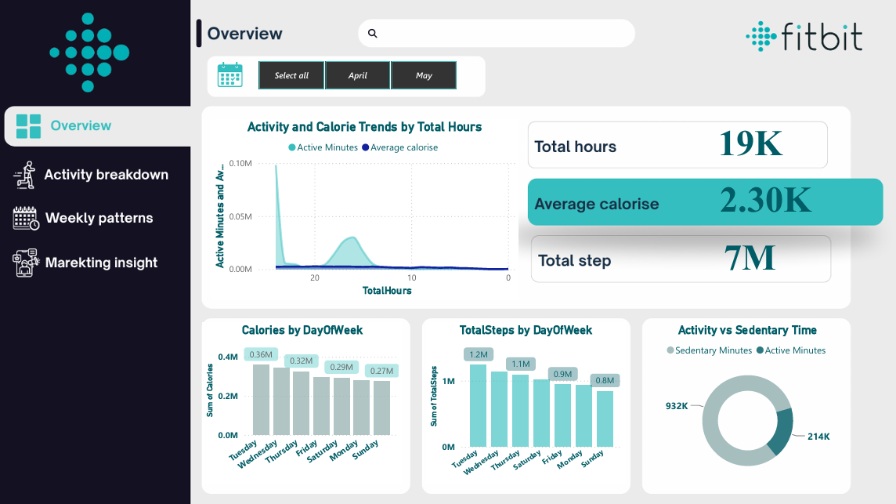

# Fitbit Activity Analytics | Power BI Dashboard

An interactive Power BI dashboard designed to analyze Fitbit activity data, calorie expenditure, daily and weekly patterns, and future activity trends. The project combines data visualization and predictive analytics to explore activity patterns and identify factors associated with calorie burn.

## 🎥 Dashboard Demo

Watch the video walkthrough to explore the dashboard pages and visualizations.

[**Watch the Fitbit Dashboard Demo**](https://drive.google.com/file/d/1i0bwlkp2xIqCZKEElgf9QK_WPmlsuVhF/view?usp=sharing)

## Dashboard Preview

### 1. Overview

Provides a summary of activity metrics, including total steps, calories, active minutes, and total hours.

- Activity and calorie trends.
- Calories burned by day of the week.
- Daily steps comparison.
- Active versus sedentary time.

### 2. Activity Breakdown

Explores activity intensity and its relationship with calorie expenditure.

- Activity intensity distribution.
- Daily active minutes trends.
- Active minutes versus calories burned.
- Monthly activity comparisons.

### 3. Weekly Patterns

Analyzes changes in physical activity and sedentary behavior across different weeks.

- Weekly steps trends.
- Weekly calories burned.
- Average active minutes by week.
- Weekly sedentary time patterns.

### 4. Marketing Insight & Predictive Analytics

Explores future activity trends and factors associated with calorie expenditure.

- Forecasted steps for upcoming weeks.
- Forecasted calorie trends.
- Key influencers affecting calorie burn.
- Analysis of activity and sedentary time.

## Key Features

- **Activity Analytics:** Analyze steps, active minutes, and sedentary time.
- **Calorie Analysis:** Explore calorie expenditure and related activity patterns.
- **Weekly Trends:** Compare activity metrics across weeks and days.
- **Predictive Analytics:** Visualize forecasts for future steps and calories.
- **Key Influencers:** Identify variables associated with changes in calorie burn.
- **Interactive Filters:** Explore data by month and year.

## Tools & Technologies

- **Microsoft Power BI** — Dashboard development and visualization.
- **Data Analytics** — Activity and calorie pattern analysis.
- **Predictive Analytics** — Forecasting and key influencer analysis.

## Repository Contents

| File | Description |
|---|---|
| `fitbit.pbix` | Original Power BI report. |
| `Overview.png` | Overview dashboard screenshot. |
| `Activity breakdown.png` | Activity analysis screenshot. |
| `Weekly patterns.png` | Weekly trends screenshot. |
| `Marketing insight.png` | Predictive analytics screenshot. |
| `README.md` | Project documentation and previews. |

## How to Explore the Project

1. Browse the dashboard screenshots above.
2. Watch the demo video to see the report in action.
3. Download `fitbit.pbix` and open it in **Power BI Desktop** to explore the report.

*Note: Data refresh may depend on the original data sources and report configuration.*

---

**Project Category:** Data Analytics & Business Intelligence  
**Primary Tool:** Microsoft Power BI  
**Focus Areas:** Activity Analytics, Calorie Analysis, Predictive Analytics
